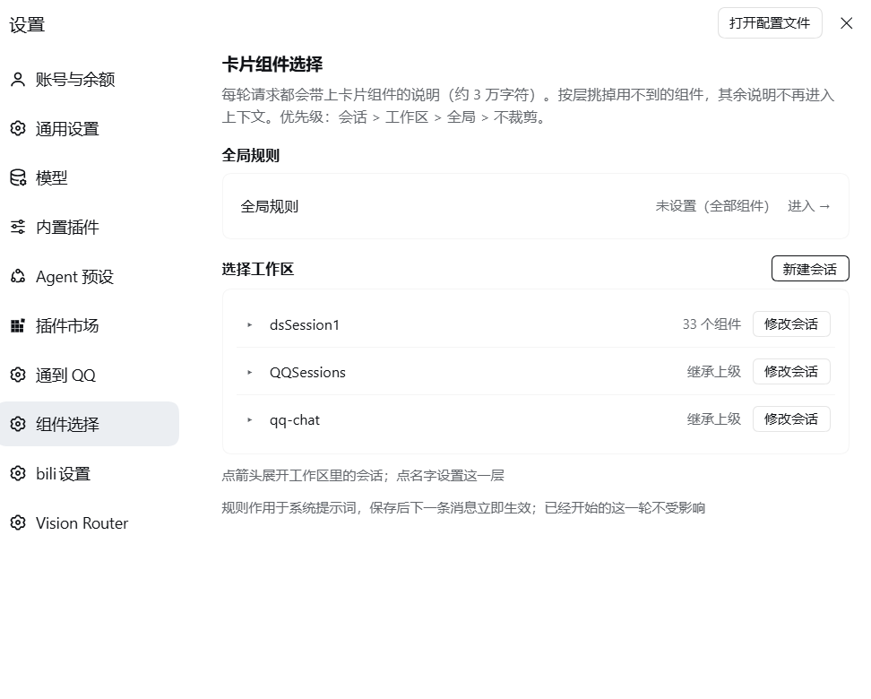

# dsh-genui-scope

给 [DeepSeek Harness](https://github.com/deepseek-ai) 用的插件：按 **全局 / 工作区 / 会话** 三级裁剪 GenUI 卡片系统提示词。

卡片能力由 `dsh-genui` 提供。它把 **46 个组件** 的完整 schema 写死进系统提示词，约 **30,900 字符**，占整个系统提示词的一半左右。但绝大多数会话只需要其中几类——写代码不需要图表，聊天不需要表格。

这个插件让你按层级选择组件，被排除的部分（组件目录、JSON Schema 里的枚举、Schema Snippets 示例）都不会再发给模型。

## 效果

对默认提示词（61,836 字符）实测：

| 方案 | 组件数 | 提示词字符 | 节省 |
| --- | --- | --- | --- |
| 不限制 | 46 | 61,836 | — |
| `lean`（文字+表单+表格） | 34 | 46,835 | 24.3% |
| `form` | 32 | 40,574 | 34.4% |
| `chart` | 31 | 40,102 | 35.1% |
| `table` | 21 | 31,362 | 49.3% |
| `text` | 18 | 23,854 | 61.4% |

省下的不只是钱——组件 schema 的噪声会让模型挑错组件，裁剪后更容易选对。

## 适用场景

系统提示词每轮都会重发一遍，组件说明那部分也不例外。对固定用途的会话——QQ 群聊、B 站刷视频、挂机闲聊这类「养鱼」场景——用不到图表、表单、表格，却每轮都带着它们的完整 schema。

QQ 群聊是这类需求最典型的样子：群里一条消息往往只有几十个字，但一天几百上千轮。每一轮都要把同样的六万多字符前缀重新带上。缓存命中能让单价降一个数量级，可频次一乘，累计的浪费仍然可观；更直接的代价是窗口——六万字符的固定开销压在那里，留给聊天本身的空间越来越小。

把这类会话所在的工作区设成 `text`：组件说明从约 3 万字降到不足 1 万，整个提示词从 61,836 字符降到 23,854，每一轮都少发这么多。同一工作区里新开的会话会自动继承，不用挨个设置。

需要卡片时把这一层改回来，下一条消息就生效；已开始的那一轮不受影响。

## 界面



其余截图见 `assets/`：全局规则、工作区会话、新建会话。

## 安装

要求：DeepSeek Harness `0.2.1-rc.5`（其他版本未验证）、`dsh-genui` 已启用。

1. 下载本仓库，或 `git clone https://github.com/SnakeDream/dsh-genui-scope.git`
2. 在 Harness 里用插件管理器安装这个目录（本地目录安装）
3. **重启一次 Harness**（host 侧的提示词过滤需要重新加载才会挂上）

首次安装必须重启；之后的规则改动即时生效，不用重启。

## 使用

打开 **设置 → 组件选择**。

- 「全局」对所有工作区生效
- 「工作区」只对该工作区下的会话生效
- 「会话」只对该会话生效
- 优先级：**会话 > 工作区 > 全局 > 不限制**

新建会话时可以先进「新建会话」，挑好组件再创建，规则会随会话一起写进去。

对话中也可以直接让模型改：

```
这个会话只要表格和图表
把当前工作区设成 lean
```

模型会调用 `card_components` 工具。

## 工具

| action | 说明 |
| --- | --- |
| `status` | 当前生效的层级与组件 |
| `catalog` | 全部可用组件 |
| `list` | 自定义预设 |
| `use` | 套用预设：`all` / `lean` / `text` / `form` / `table` / `chart` |
| `set` | 显式指定组件列表 |
| `clear` | 清除某层规则 |

## 配置

状态默认存在 `$DSH_HOME/genui-scope.json`。插件配置项（都可改）：

| 键 | 默认值 | 说明 |
| --- | --- | --- |
| `stateFile` | `genui-scope.json` | 状态文件名 |
| `logFile` | `genui-scope.log` | 告警日志 |
| `routePrefix` | `/api/genui-scope` | 设置页用的 HTTP 路由前缀 |
| `sectionPattern` | `genui` | 要拦截的提示词 section 名匹配 |
| `force` | `["TinyCard"]` | 永远保留的组件 |
| `anchors` | 三条中文锚点 | 提示词里组件段落的起始标记 |

## 原理与边界

插件监听 `system-prompt/assemble`，在 `dsh-genui` 注册的那个提示词 section 上做文本裁剪。它不改 `dsh-genui` 本身，也不增加新的事件类型。

这意味着：

- 如果 `dsh-genui` 被关闭，或它的 section 改名，插件就不会有任何效果（设置页照样能选）
- 如果提示词锚点被上游改掉，插件会静默跳过并在 `genui-scope.log` 里告警一次
- 官方实践并不建议在 `system-prompt/assemble` 里增删文本；这里这么做是因为 `dsh-genui` 没有提供按会话裁剪的接口

## 适配说明

以下内容与 DSH 版本绑定，升级后可能失效：

- 会话日志格式：`session.v4.jsonl.zstd`（zstd 多帧）、`session/title` 事件、`header.cwd`
- `$DSH_HOME/storages/workspace.json` 的结构
- 会话目录名编码（`--C-...--`）
- client 侧 slot：`settings.section`，以及 `@deepseek-ai/dsh-client-ui-conversation`

同一版本的 Harness 下可用；跨版本不保证。遇到问题先看 `genui-scope.log`。

## License

MIT
